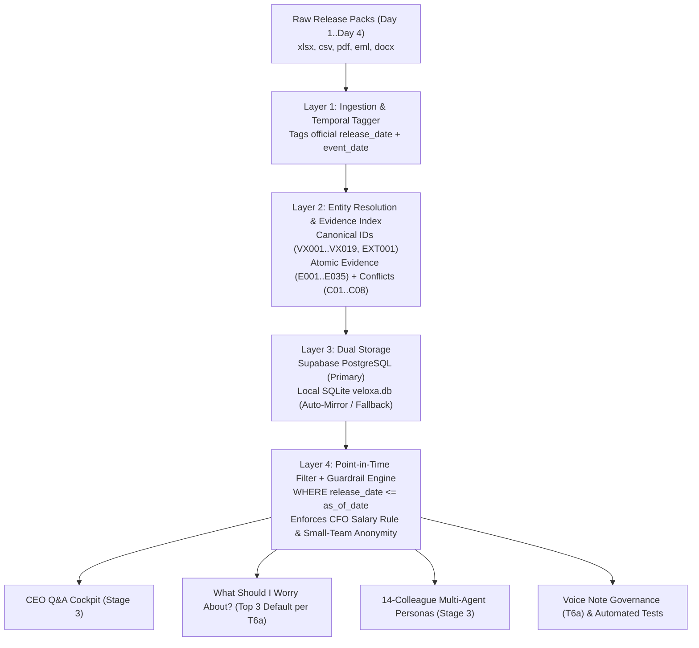

# Veloxa CXO Cockpit — System Architecture

> **Stage:** Day 2 (`2026-11-17`) — HR Ingestion, Ranked Risk Engine & Voice Note T6a  
> **Repository:** `veloxa-cockpit-samrat-sengupta`

---

## 1. Design Philosophy & Constraints

1. **Interview-Defensible Simplicity:** Built in modular Python 3.11+ with explicit SQL queries and deterministic guardrails rather than opaque orchestration frameworks. Every query, conflict check, and refusal rule can be inspected and modified directly.
2. **Fresh-Clone Reliability:** Evaluators run a single command from a fresh clone. Therefore, the database layer uses **Supabase PostgreSQL** as the cloud store when configured, paired with an automatic **local SQLite mirror (`veloxa.db`)** so setup, ingestion, and tests run offline with zero external dependencies.
3. **Structured Evidence First, LLM Synthesis Second:** Numbers, entity resolutions, temporal filters, and policy guardrails are computed deterministically in SQL/Python before any text is sent to Groq (`llama-3.3-70b-versatile`). If `GROQ_API_KEY` is absent or rate-limited, the cockpit degrades gracefully to a deterministic citation formatter.

---

## 2. Five-Layer Architecture



### Layer 1: Ingestion & Temporal Tagger (`ingest/`)
- [`ingest/temporal.py`](ingest/temporal.py) maps each release drop folder to its official `release_date` (`Day1_Mon_16Nov` -> `2026-11-16`, `Day2_Tue_17Nov` -> `2026-11-17`, etc.).
- [`ingest/day1_loader.py`](ingest/day1_loader.py) parses Day 1 Finance/Employee files (`release_date = 2026-11-16`).
- [`ingest/day2_loader.py`](ingest/day2_loader.py) parses Day 2 HR/Requisitions/Survey/Transcript files (`release_date = 2026-11-17`), extracting:
  - `Hiring_Tracker.xlsx` -> `hiring_reqs` (6 requisitions, Keka Hire ATS, paused date on REQ-014/015).
  - `Leave_Register.xlsx` -> `leave_records` (19 leave records with normalized dates and days).
  - `Pulse_Survey.xlsx` -> `pulse_surveys` (24 team survey rows with forced `comments_withheld = True`).
  - `Resignation_Letter_SM.pdf` -> `documents` (`DOC_RESIGNATION_SM`).
  - Emails `06.eml`, `07.eml`, `10.eml`, `11.eml` -> `emails`.
  - Transcripts `T3_Head_of_People_Call.docx` and `T6a_CEO_Voice_Note.docx` -> `documents`.
- Every ingestion run is logged in `ingestion_runs`.

### Layer 2: Entity Resolution & Evidence Index (`db/schema.sql`)
- `employees`: Canonical employee directory (`VX001`–`VX019`, contractors `EXT*`) with `is_agent_persona` marking the 14 target colleagues across Engineering, Finance, People & Ops, and Marketing.
- `reporting_lines`: Temporal manager/department mapping (`effective_from`, `effective_to`) so org structure changes do not break historical queries.
- `entity_aliases`: Maps initials (`KS`, `FS`, `PN`, `SM`), transcript mishearings (`Joho books` -> Zoho Books, `Kayka` -> Keka, `Jeera` -> Jira, `Cult Amp` -> Culture Amp, `Liver` -> Lever, `Kartik` -> Karthik Subramanian, `Sid` -> Siddharth Mehta), and vendor variants to canonical IDs.
- `evidence_index`: 35 atomic, immutable claims (`E001`..`E035`) with exact file/sheet/row coordinates, reliability ratings, and conflict group IDs.
- `conflicts`: 8 explicit link records (`C01`..`C08`) connecting contradictory claims across transcripts, board updates, emails, and operational exports.

### Layer 3: Dual Storage (`db/database.py`)
- Single DDL source of truth in [`db/schema.sql`](db/schema.sql).
- `DatabaseManager` initializes and mirrors into local `veloxa.db` (SQLite) while maintaining real-time parity with Supabase PostgreSQL (`DATABASE_URL`).
- Strict schema boundaries:
  - `payroll_summary`: Department/month aggregates safe for CEO Q&A.
  - `payroll_restricted`: Individual proration audit rows isolated from direct Q&A output per CFO confidentiality rules (`T2_CFO_Call.docx`).
  - `pulse_surveys`: Captures Culture Amp quarterly engagement scores with `comments_withheld = TRUE` enforced at ingestion time.

### Layer 4: Point-in-Time & Guardrail Engine (`cockpit/risk_engine.py`)
- **Temporal Isolation:** Every cockpit query filters `WHERE release_date <= :as_of_date`. Day 1 queries never see Day 2 evidence (`E022`..`E035`), preventing retroactive data leakage.
- **Guardrail Rules:**
  1. **Salary Ban:** Block individual employee salary/CTC disclosures (`T2` CFO rule); return department/company aggregates only.
  2. **Anonymity Protection:** Enforce Culture Amp survey anonymity (`< 6` respondents per team suppresses qualitative comments).
  3. **No Private Surveillance / Flight-Risk Scoring:** Refuse requests to scrape private Slack messages or rank individuals by quit probability.
  4. **Data Honesty:** Explicitly state `"I don't know — not in the data room"` when requested metrics (e.g. HubSpot pipeline, LinkedIn campaign spend) are absent.

### Layer 5: Application Modules & Executive UI
- [`app.py`](app.py) (Streamlit multi-tab CXO Cockpit):
  - **Sidebar Time Machine:** Toggle operating horizon between Day 1 (`2026-11-16`) and Day 2 (`2026-11-17`).
  - **Tab 1: "What Should I Worry About? (Top 3)" (Default Landing):** Implements Voice Note `T6a` with zero-prompt executive risk brief and expandable `#4+` audit drawer.
  - **Tab 2: "Voice Note Responses (T6a)":** Displays voice note transcript and formal decision document.
  - **Tab 3: "Evidence & Conflict Explorer":** Filterable view of evidence, active conflicts, and domain tables.
  - **Tab 4 & 5:** Previews of Grounded CEO Q&A Chatbot and 14 Colleague AI Agents (unlocking in Stage 3).
- [`cockpit/risk_engine.py`](cockpit/risk_engine.py): Ranked Risk Engine prioritizing strategic vulnerabilities by business severity and evidence corroboration.
- [`run.py`](run.py): Unified CLI supporting `--setup`, `--ingest-day1`, `--ingest-day2`, `--ingest-all`, `--worries`, `--as-of`, `--status`, and `--test`.

---

## 3. Repository Layout

```text
veloxa-cockpit-samrat-sengupta/
├── README.md
├── ARCHITECTURE.md
├── ASSUMPTIONS.md
├── TRANSCRIPT_NOTES.md
├── DECISIONS.md
├── AI_LOG.md
├── app.py                      # Streamlit CXO Cockpit UI
├── run.py                      # Unified CLI Runner
├── requirements.txt
├── .env.example
├── .gitignore
├── cockpit/
│   ├── __init__.py
│   └── risk_engine.py         # Ranked Risk Engine (Top 3 per T6a)
├── db/
│   ├── __init__.py
│   ├── schema.sql             # Unified PostgreSQL + SQLite DDL
│   └── database.py           # Dual-backend connection manager
├── ingest/
│   ├── __init__.py
│   ├── temporal.py           # Temporal tagging & release calendar
│   ├── day1_loader.py        # Day 1 ingestion pipeline
│   └── day2_loader.py        # Day 2 ingestion pipeline
├── voice_notes/
│   └── T6a_response.md        # Written response to CEO voice note T6a
└── tests/
    ├── __init__.py
    ├── test_stage1_foundation.py
    └── test_stage2_day2.py    # Day 2 ingestion, isolation & risk tests
```
