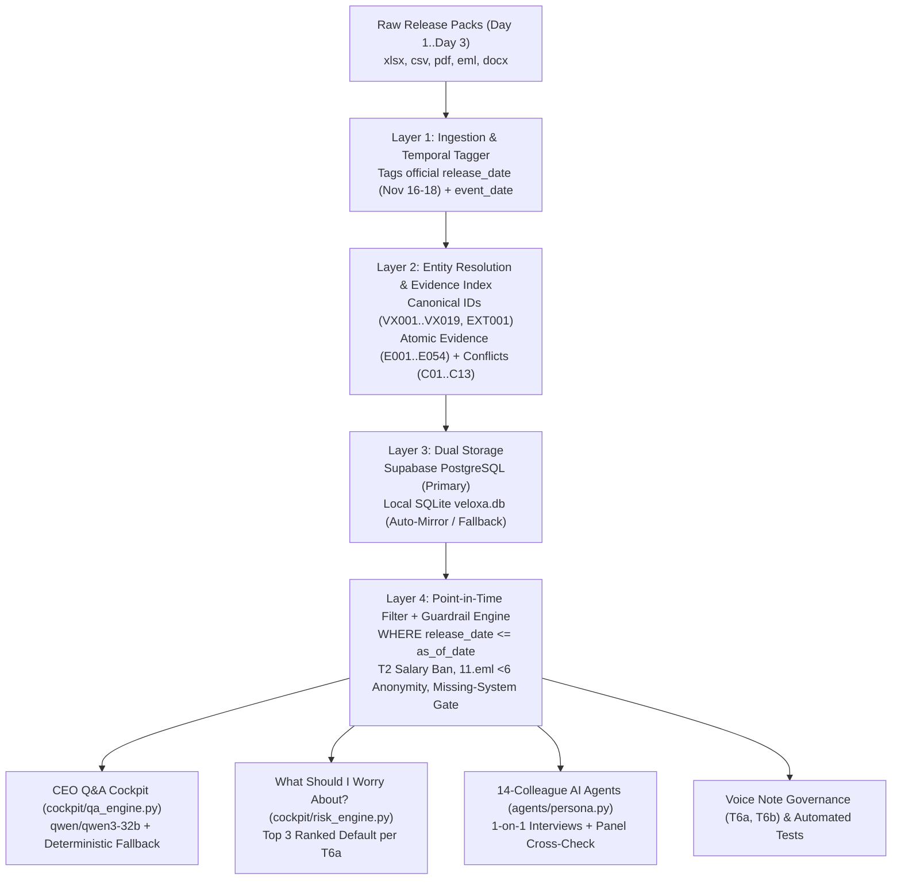

# Veloxa CXO Cockpit — System Architecture

> **Stage:** Day 3 (`2026-11-18`) — Engineering/Marketing Ingestion, Guardrails, CEO Q&A, 14 AI Agents & Voice Note T6b  
> **Repository:** `veloxa-cockpit-samrat-sengupta`

---

## 1. Design Philosophy & Constraints

1. **Interview-Defensible Simplicity:** Built in modular Python 3.11+ with explicit SQL queries and deterministic guardrails rather than opaque orchestration frameworks. Every query, conflict check, and refusal rule can be inspected and modified directly.
2. **Fresh-Clone Reliability:** Evaluators run a single command from a fresh clone. Therefore, the database layer uses **Supabase PostgreSQL** as the cloud store when configured, paired with an automatic **local SQLite mirror (`veloxa.db`)** so setup, ingestion, and tests run offline with zero external dependencies.
3. **Structured Evidence First, LLM Synthesis Second:** Numbers, entity resolutions, temporal filters, and policy guardrails are computed deterministically in SQL/Python before any text is sent to Groq (`qwen/qwen3-32b` with automatic fallback to `llama-3.3-70b-versatile` / available Groq models and `<think>` tag stripping). If `GROQ_API_KEY` is absent or offline, the cockpit degrades gracefully to a deterministic SQL + evidence-index citation synthesizer.

---

## 2. Five-Layer Architecture



### Layer 1: Ingestion & Temporal Tagger (`ingest/`)
- [`ingest/temporal.py`](ingest/temporal.py) maps each release drop folder to its official `release_date` (`Day1_Mon_16Nov` -> `2026-11-16`, `Day2_Tue_17Nov` -> `2026-11-17`, `Day3_Wed_18Nov` -> `2026-11-18`).
- [`ingest/day1_loader.py`](ingest/day1_loader.py) parses Day 1 Finance/Employee files (`release_date = 2026-11-16`).
- [`ingest/day2_loader.py`](ingest/day2_loader.py) parses Day 2 HR/Requisitions/Survey/Transcript files (`release_date = 2026-11-17`).
- [`ingest/day3_loader.py`](ingest/day3_loader.py) parses Day 3 Engineering/Marketing/Operations files (`release_date = 2026-11-18`):
  - `Jira_Export_ATLAS.xlsx` -> `jira_versions` (1 version: `Atlas GA` pushed to `2026-12-15` by `VX004`) + `jira_issues` (62 stories across 5 epics).
  - `git_log.csv` -> `git_commits` (1,453 commits converted to IST `UTC+05:30`, flagging late-night `22:00–05:59` and weekend commits, resolving `pnair@users.noreply.github.com` + `priya.n@veloxa.in` to `VX007`).
  - `Incidents_Aug-Oct_2026.xlsx` -> `incidents` (11 PagerDuty incidents resolving `Sneha` -> `VX012` and `Snehal` -> `EXT001`).
  - `OnCall_Rota.xlsx` -> `oncall_rota` (17 weekly primary/secondary rotations).
  - `Atlas_Launch_Kit_v1.pdf`, `Invoice_PIS-114.pdf`, `Email_Printouts.pdf`, `T4_Head_of_Marketing_Call.docx`, `T5_VP_Engineering_Call.docx`, `T6b_CEO_Voice_Note.docx` -> `documents` (6 Day 3 docs, 17 total).
  - Emails `04.eml`, `05.eml`, `08.eml`, `09.eml` -> `emails` (4 Day 3 emails, 11 total).
  - Seeds 21 Day 3 `entity_aliases` (61 total), 19 Day 3 `evidence_index` records `E036`–`E054` (54 total), 5 Day 3 `conflicts` `C09`–`C13` (13 total), 14 `agent_profiles`, and `T6b` in `voice_note_decisions`.

### Layer 2: Entity Resolution & Evidence Index (`db/schema.sql`)
- `employees`: Canonical employee directory (`VX001`–`VX019`) with `is_agent_persona` marking the 14 target colleagues across Engineering, Finance, People & Ops, and Marketing.
- `reporting_lines`: Temporal manager/department mapping (`effective_from`, `effective_to`) queried via `get_reporting_line_as_of()` (`T6b` org resilience).
- `entity_aliases`: 61 mappings resolving initials (`PN`, `AD`, `RV`, `SK`, `KS`, `FS`, `SM`), nicknames (`Pria`, `Sid`, `Vicky`, `Ayesha`), dual GitHub emails (`pnair@users.noreply.github.com` -> `VX007`), contractor separation (`Sneha` -> `VX012` vs. `Snehal`/`S. Patil` -> `EXT001`), Sapphire vendors, and ASR tool mishearings (`Jeera`, `Cult Amp`, `slag`, `hub sport`, `Joho books`, `Kayka`, `Liver`).
- `evidence_index`: 54 atomic, immutable claims (`E001`..`E054`) with exact file/sheet/row coordinates, reliability ratings, and conflict group IDs.
- `conflicts`: 13 explicit link records (`C01`..`C13`) connecting contradictory claims across transcripts, board updates, emails, and operational exports.

### Layer 3: Dual Storage (`db/database.py`)
- Single DDL source of truth in [`db/schema.sql`](db/schema.sql).
- `DatabaseManager` initializes and mirrors all 21 tables into local `veloxa.db` (SQLite) while maintaining real-time parity with Supabase PostgreSQL (`DATABASE_URL`), using fast batch `execute_values` for 1,453 `git_commits`.
- Strict schema isolation between `payroll_summary` (safe department aggregates) and `payroll_restricted` (internal proration audit only).

### Layer 4: Point-in-Time, Guardrails & CEO Q&A (`cockpit/`)
- [`cockpit/guardrails.py`](cockpit/guardrails.py):
  1. **Individual Salary Ban (`T2`):** Refuses individual employee salary/compensation disclosures and offers safe `payroll_summary` department totals.
  2. **Small-Team Survey Anonymity (`11.eml`):** Refuses raw/individual Culture Amp survey comments for teams `< 6` respondents (all Veloxa teams have `<= 5`).
  3. **No Surveillance / Quit-Probability Ranking:** Refuses Slack scraping or employee flight-risk ranking.
  4. **Missing System / Unknown Fact Detector:** Returns `"I don't know"` (`confidence = "Low"`) when asked about unexported systems (`Slack`, `HubSpot`, `LinkedIn Campaign Manager`, `Linear`, `Confluence`, `REQ-012`, post-Sep GL/payroll).
  5. **Point-in-Time Enforcer:** Validates `as_of_date` and enforces `WHERE release_date <= :as_of_date` across every query.
- [`cockpit/qa_engine.py`](cockpit/qa_engine.py): Structured SQL + Evidence-Index hybrid `ask_cockpit(db, question, as_of_date)` powered by Groq `qwen/qwen3-32b` (`GROQ_MODEL` override, automatic fallback chain, `<think>` stripping) plus deterministic offline fallback returning `answer`, `confidence`, `confidence_reason`, `sources_disagree`, `refusal`, `citations`, and `as_of_date`.
- [`cockpit/risk_engine.py`](cockpit/risk_engine.py): Dynamic Point-in-Time Top 3 Ranked Strategic Worries across Day 1 (`<= 2026-11-16`), Day 2 (`2026-11-17`), and Day 3+ (`>= 2026-11-18`).

### Layer 5: 14 Colleague AI Agents & Executive UI (`agents/`, `app.py`, `run.py`)
- [`agents/persona.py`](agents/persona.py):
  - `build_agent_context(db, emp_id, as_of_date)`: Dynamically builds each colleague's Point-in-Time work stats, visibility scope, and `[Assumed]` personal-life profile.
  - `interview_agent(db, emp_id, question, as_of_date)`: First-person 1-on-1 interview enforcing guardrails and temporal isolation.
  - `panel_interview(db, target_ids_or_dept, question, as_of_date)`: Side-by-side multi-agent responses plus Cockpit Truth Synthesis highlighting cross-source conflicts.
- [`app.py`](app.py): Streamlit CXO Cockpit with 3-horizon Time Machine (`2026-11-16`, `2026-11-17`, `2026-11-18`), Top 3 Worries landing view, Voice Note `T6a`/`T6b` briefs, Evidence & Conflict Explorer (including Jira, Git, Incidents, On-Call), Interactive CEO Q&A Chatbot, and 14 Colleague AI Agents (1-on-1 + Panel Cross-Check).
- [`run.py`](run.py): Unified CLI supporting `--setup`, `--ingest-day1`, `--ingest-day2`, `--ingest-day3`, `--ingest-all`, `--worries`, `--ask`, `--interview`, `--panel`, `--as-of`, `--status`, and `--test`.

---

## 3. Repository Layout

```text
veloxa-cockpit-samrat-sengupta/
├── README.md
├── ARCHITECTURE.md
├── ASSUMPTIONS.md
├── TRANSCRIPT_NOTES.md
├── DECISIONS.md
├── AI_LOG.md
├── app.py                      # Streamlit CXO Cockpit UI
├── run.py                      # Unified CLI Runner
├── requirements.txt
├── .env.example
├── .gitignore
├── agents/
│   ├── __init__.py
│   └── persona.py              # 14 Colleague AI Personas (1-on-1 & Panel)
├── cockpit/
│   ├── __init__.py
│   ├── guardrails.py           # Salary, Anonymity, Missing-Data & Temporal Guardrails
│   ├── qa_engine.py            # Grounded CEO Q&A Engine (Groq + Deterministic Fallback)
│   └── risk_engine.py          # Ranked Risk Engine (Top 3 per T6a)
├── db/
│   ├── __init__.py
│   ├── schema.sql              # Unified PostgreSQL + SQLite DDL
│   └── database.py             # Dual-backend connection manager + temporal reporting lines
├── ingest/
│   ├── __init__.py
│   ├── temporal.py             # Temporal tagging & release calendar
│   ├── day1_loader.py          # Day 1 ingestion pipeline
│   ├── day2_loader.py          # Day 2 ingestion pipeline
│   └── day3_loader.py          # Day 3 ingestion pipeline
├── voice_notes/
│   ├── T6a_response.md         # Written response to CEO voice note T6a
│   └── T6b_response.md         # Written response to CEO voice note T6b
└── tests/
    ├── __init__.py
    ├── test_stage1_foundation.py
    ├── test_stage2_day2.py
    └── test_stage3_day3.py     # Day 3 ingestion, guardrails, Q&A, and 14-agent tests
```
