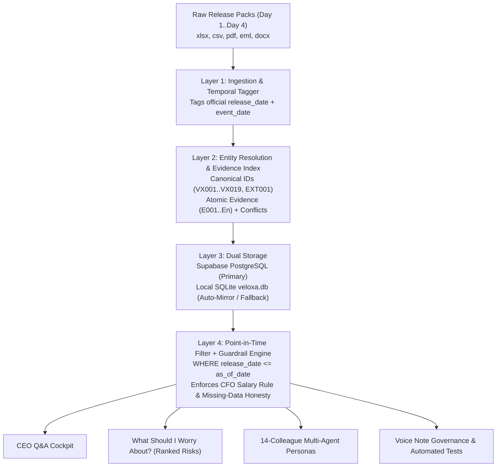

# Veloxa CXO Cockpit — System Architecture

> **Stage:** Day 1 (`2026-11-16`) Foundation  
> **Repository:** `veloxa-cockpit-samrat-sengupta`

---

## 1. Design Philosophy & Constraints

1. **Interview-Defensible Simplicity:** Built in modular Python 3.11+ with explicit SQL queries and deterministic guardrails rather than opaque orchestration frameworks. Every query, conflict check, and refusal rule can be inspected and modified directly.
2. **Fresh-Clone Reliability:** Evaluators run a single command from a fresh clone. Therefore, the database layer uses **Supabase PostgreSQL** as the cloud store when configured, paired with an automatic **local SQLite mirror (`veloxa.db`)** so setup, ingestion, and tests run offline with zero external dependencies.
3. **Structured Evidence First, LLM Synthesis Second:** Numbers, entity resolutions, temporal filters, and policy guardrails are computed deterministically in SQL/Python before any text is sent to Groq (`llama-3.3-70b-versatile`). If `GROQ_API_KEY` is absent or rate-limited, the cockpit degrades gracefully to a deterministic citation formatter.

---

## 2. Five-Layer Architecture



### Layer 1: Ingestion & Temporal Tagger (`ingest/`)
- [`ingest/temporal.py`](ingest/temporal.py) maps each release drop folder to its official `release_date` (`Day1_Mon_16Nov` -> `2026-11-16`, etc.).
- [`ingest/day1_loader.py`](ingest/day1_loader.py) parses Day 1 `.xlsx`, `.pdf`, `.docx`, `.eml`, and `.txt` files into normalized tables, tagging every row with both `release_date` and `event_date`.
- Every ingestion run is logged in `ingestion_runs`.

### Layer 2: Entity Resolution & Evidence Index (`db/schema.sql`)
- `employees`: Canonical employee directory (`VX001`–`VX019`, contractors `EXT*`) with `is_agent_persona` marking the 14 target colleagues across Engineering, Finance, People & Ops, and Marketing.
- `reporting_lines`: Temporal manager/department mapping (`effective_from`, `effective_to`) so org structure changes do not break historical queries.
- `entity_aliases`: Maps initials (`KS`, `FS`, `PN`), transcript mishearings (`Joho books` -> Zoho Books, `Kayka` -> Keka, `Jeera` -> Jira, `Kartik` -> Karthik Subramanian), and vendor variants to canonical IDs.
- `evidence_index`: Atomic, immutable claims (`evidence_id`, `source_file`, `source_type`, `location`, `fact_text`, `event_date`, `release_date`, `reliability`, `conflict_group_id`).
- `conflicts`: Explicit link table connecting contradictory claims across transcripts, board updates, emails, and operational exports.

### Layer 3: Dual Storage (`db/database.py`)
- Single DDL source of truth in [`db/schema.sql`](db/schema.sql).
- `DatabaseManager` initializes and mirrors into local `veloxa.db` (SQLite) while supporting Supabase PostgreSQL (`DATABASE_URL`) when configured.
- Payroll data is split at the schema boundary:
  - `payroll_summary`: Department/month aggregates safe for CEO Q&A.
  - `payroll_restricted`: Individual proration audit rows isolated from direct Q&A output per CFO confidentiality rules (`T2_CFO_Call.docx`).

### Layer 4: Point-in-Time & Guardrail Engine (Planned Stage 2–4)
- **Temporal Isolation:** Every cockpit query filters `release_date <= :as_of_date`, preventing later release drops from leaking into earlier-day answers.
- **Guardrail Rules:**
  1. Block individual employee salary/CTC disclosures (`T2` CFO rule); return department/company aggregates only.
  2. Enforce small-team survey anonymity (`< 6` respondents per team).
  3. Refuse undocumented systems or uncaptured channels honestly (`"I don't know — not in the data room"`).

### Layer 5: Application Modules (Planned Stage 2–5)
- `app.py` (Streamlit multi-tab CXO Cockpit)
- Ranked Risk Engine (`What Should I Worry About?`)
- Grounded CEO Q&A with citations, confidence, and source-disagreement callouts
- 14-Colleague Multi-Agent System (1-on-1 & Department Panel modes)
- 25+ `pytest` automated tests including refusal, point-in-time, and math reconciliation checks

---

## 3. Repository Layout

```text
veloxa-cockpit-samrat-sengupta/
├── README.md
├── ARCHITECTURE.md
├── ASSUMPTIONS.md
├── TRANSCRIPT_NOTES.md
├── DECISIONS.md
├── AI_LOG.md
├── .env.example
├── .gitignore
├── requirements.txt
├── run.py
├── db/
│   ├── __init__.py
│   ├── schema.sql
│   └── database.py
├── ingest/
│   ├── __init__.py
│   ├── temporal.py
│   └── day1_loader.py
└── tests/
    ├── __init__.py
    └── test_stage1_foundation.py
```
