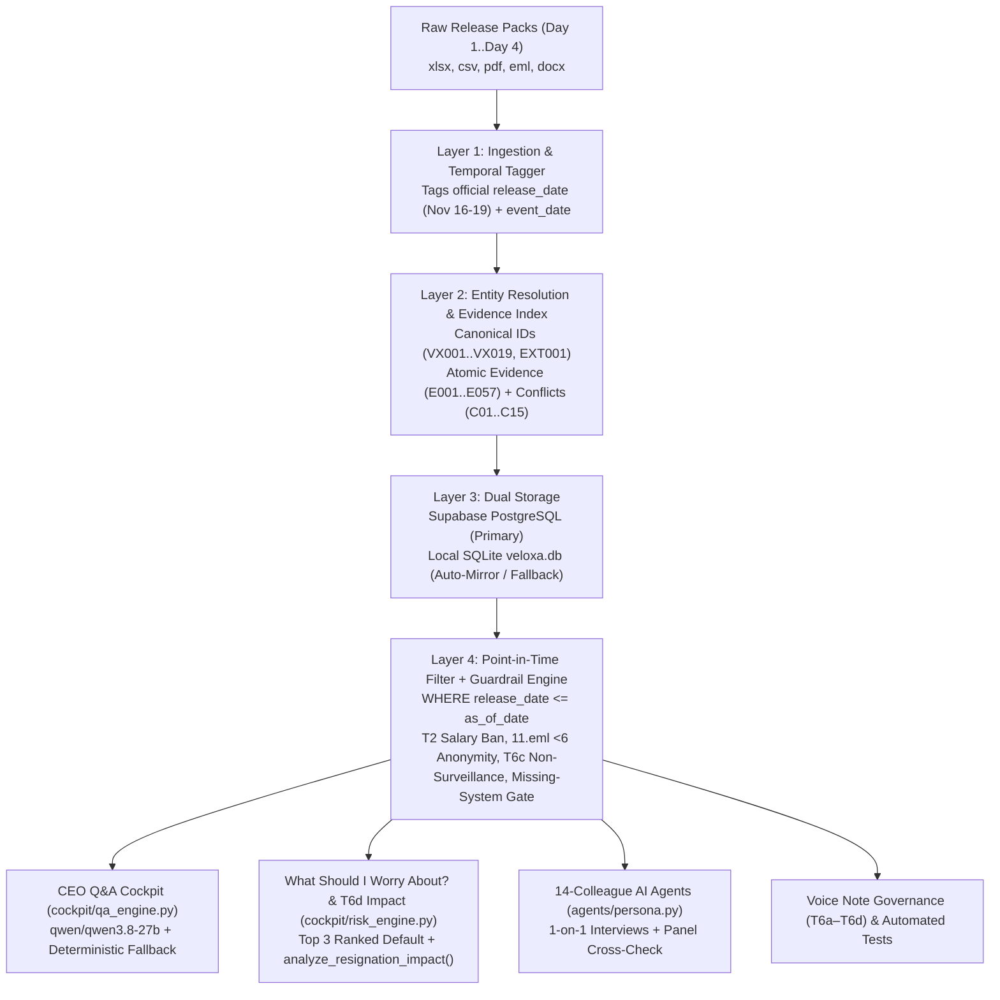

# Veloxa CXO Cockpit — System Architecture

> **Stage:** Day 4 (`2026-11-19`) — `T6c` Guardrail Enforcement, `T6d` Resignation Impact Analyzer & Full 4-Day Time Machine  
> **Repository:** `veloxa-cockpit-samrat-sengupta`

---

## 1. Design Philosophy & Constraints

1. **Interview-Defensible Simplicity:** Built in modular Python 3.11+ with explicit SQL queries and deterministic guardrails rather than opaque orchestration frameworks. Every query, conflict check, and refusal rule can be inspected and modified directly.
2. **Fresh-Clone Reliability:** Evaluators run a single command from a fresh clone. Therefore, the database layer uses **Supabase PostgreSQL** as the cloud store when configured, paired with an automatic **local SQLite mirror (`veloxa.db`)** so setup, ingestion, and tests run offline with zero external dependencies.
3. **Structured Evidence First, LLM Synthesis Second:** Numbers, entity resolutions, temporal filters, and policy guardrails are computed deterministically in SQL/Python before any text is sent to Groq (`qwen/qwen3.8-27b` primary with automatic fallback to `llama-3.3-70b-versatile` / `openai/gpt-oss-120b` and `<think>` tag stripping). If `GROQ_API_KEY` is absent or offline, the cockpit degrades gracefully to a deterministic SQL + evidence-index citation synthesizer.

---

## 2. Five-Layer Architecture



### Layer 1: Ingestion & Temporal Tagger (`ingest/`)
- [`ingest/temporal.py`](ingest/temporal.py) maps each release drop folder to its official `release_date` (`Day1_Mon_16Nov` -> `2026-11-16`, `Day2_Tue_17Nov` -> `2026-11-17`, `Day3_Wed_18Nov` -> `2026-11-18`, `Day4_Thu_19Nov` -> `2026-11-19`) and defines `DAY1_FILES`..`DAY4_FILES`.
- [`ingest/day1_loader.py`](ingest/day1_loader.py) parses Day 1 Finance/Employee files (`release_date = 2026-11-16`).
- [`ingest/day2_loader.py`](ingest/day2_loader.py) parses Day 2 HR/Requisitions/Survey/Transcript files (`release_date = 2026-11-17`).
- [`ingest/day3_loader.py`](ingest/day3_loader.py) parses Day 3 Engineering/Marketing/Operations files (`release_date = 2026-11-18`):
  - `Jira_Export_ATLAS.xlsx` -> `jira_versions` (1 version: `Atlas GA` pushed to `2026-12-15` by `VX004`) + `jira_issues` (62 stories across 5 epics).
  - `git_log.csv` -> `git_commits` (1,453 commits converted to IST `UTC+05:30`, flagging late-night `22:00–05:59` and weekend commits, resolving `pnair@users.noreply.github.com` + `priya.n@veloxa.in` to `VX007`).
  - `Incidents_Aug-Oct_2026.xlsx` -> `incidents` (11 PagerDuty incidents resolving `Sneha` -> `VX012` and `Snehal` -> `EXT001`).
  - `OnCall_Rota.xlsx` -> `oncall_rota` (17 weekly primary/secondary rotations).
  - `Atlas_Launch_Kit_v1.pdf`, `Invoice_PIS-114.pdf`, `Email_Printouts.pdf`, `T4_Head_of_Marketing_Call.docx`, `T5_VP_Engineering_Call.docx`, `T6b_CEO_Voice_Note.docx` -> `documents` (6 Day 3 docs, 17 cumulative through Day 3).
  - Emails `04.eml`, `05.eml`, `08.eml`, `09.eml` -> `emails` (4 Day 3 emails, 11 total).
- [`ingest/day4_loader.py`](ingest/day4_loader.py) parses Day 4 CEO Voice Notes (`release_date = 2026-11-19`; confirmed `Day4_Thu_19Nov/data_room` has zero files):
  - `T6c_CEO_Voice_Note.docx` (`VOICE_NOTE_T6C`) and `T6d_CEO_Voice_Note.docx` (`VOICE_NOTE_T6D`) -> `documents` (19 total).
  - Seeds 2 Day 4 `entity_aliases` (`63` total), 3 Day 4 `evidence_index` records `E055`–`E057` (`57` total), 2 Day 4 `conflicts` `C14`–`C15` (`15` total), and `T6c` (`refused`) + `T6d` (`implemented`) in `voice_note_decisions` (`4` total).
  - **Temporal Non-Mutation Rule:** Priya Nair's Day 4 resignation is stored exclusively in Day 4 (`release_date = '2026-11-19'`) records rather than mutating Day 1 `employees`, preserving strict non-leakage on `2026-11-16`..`2026-11-18`.

### Layer 2: Entity Resolution & Evidence Index (`db/schema.sql`)
- `employees`: Canonical employee directory (`VX001`–`VX019`) with `is_agent_persona` marking the 14 target colleagues across Engineering, Finance, People & Ops, and Marketing.
- `reporting_lines`: Temporal manager/department mapping (`effective_from`, `effective_to`) queried via `get_reporting_line_as_of()` (`T6b` org resilience).
- `entity_aliases`: 63 mappings resolving initials (`PN`, `AD`, `RV`, `SK`, `KS`, `FS`, `SM`), nicknames (`Pria`, `Sid`, `Vicky`, `Ayesha`), project handles (`version three` -> `PROJ_ATLAS_V3`), dual GitHub emails (`pnair@users.noreply.github.com` -> `VX007`), contractor separation (`Sneha` -> `VX012` vs. `Snehal`/`S. Patil` -> `EXT001`), Sapphire vendors, and ASR tool mishearings (`Jeera`, `Cult Amp`, `slag`, `slag messages`, `hub sport`, `Joho books`, `Kayka`, `Liver`).
- `evidence_index`: 57 atomic, immutable claims (`E001`..`E057`) with exact file/sheet/row coordinates, reliability ratings, and conflict group IDs.
- `conflicts`: 15 explicit link records (`C01`..`C15`) connecting contradictory claims across transcripts, voice notes, board updates, emails, and operational exports.

### Layer 3: Dual Storage (`db/database.py`)
- Single DDL source of truth in [`db/schema.sql`](db/schema.sql).
- `DatabaseManager` initializes and mirrors all 21 tables into local `veloxa.db` (SQLite) while maintaining real-time parity with Supabase PostgreSQL (`DATABASE_URL`), using fast batch `execute_values` for 1,453 `git_commits`.
- Strict schema isolation between `payroll_summary` (safe department aggregates) and `payroll_restricted` (internal proration audit only).

### Layer 4: Point-in-Time, Guardrails, CEO Q&A & Risk/Impact Engine (`cockpit/`)
- [`cockpit/guardrails.py`](cockpit/guardrails.py):
  1. **Individual Salary Ban (`T2`):** Refuses individual employee salary/compensation disclosures (`status = "refused_guardrail"`) and offers safe `payroll_summary` department totals.
  2. **Small-Team Survey Anonymity (`11.eml`):** Refuses raw/individual Culture Amp survey comments (`status = "refused_guardrail"`) for teams `< 6` respondents (all Veloxa teams have `<= 5`).
  3. **No Surveillance / Quit-Probability Ranking (`T6c`):** Refuses employee quit/flight-risk ranking and private Slack (`"slag"`) scraping/inspection (`status = "refused_guardrail"`, `refusal = True`, `guardrail_type = "NO_SURVEILLANCE_RANKING"`), offering objective workload/leave/aggregate team pulse indicators instead.
  4. **Missing System / Unknown Fact Detector:** Returns `"I don't know"` (`status = "missing_data"`, `confidence = "Low"`) when asked about unexported systems (`Slack`, `HubSpot`, `LinkedIn Campaign Manager`, `Linear`, `Confluence`, `REQ-012`, post-Sep GL/payroll).
  5. **Point-in-Time Enforcer:** Validates `as_of_date` and enforces `WHERE release_date <= :as_of_date` across every query.
- [`cockpit/qa_engine.py`](cockpit/qa_engine.py): Structured SQL + Evidence-Index hybrid `ask_cockpit(db, question, as_of_date)` powered by Groq `qwen/qwen3.8-27b` (`GROQ_MODEL` override, fallback to `llama-3.3-70b-versatile` & `openai/gpt-oss-120b`, `<think>` stripping) plus deterministic offline fallback returning `status`, `answer`, `confidence`, `confidence_reason`, `sources_disagree`, `refusal`, `citations`, and `as_of_date`.
- [`cockpit/risk_engine.py`](cockpit/risk_engine.py):
  - `get_ranked_worries()`: Dynamic Point-in-Time Top 3 Ranked Strategic Worries across Day 1 (`<= 2026-11-16`), Day 2 (`2026-11-17`), Day 3 (`2026-11-18`), and Day 4+ (`>= 2026-11-19`).
  - `analyze_resignation_impact(db, employee_id, as_of_date)`: Computes exact Jira story/point/epic SPOF exposure (`35/62` stories, `14/27` open = `62/115` open pts, `100% ATLAS-2`), `git_log` share (`588/1,453` total, `588/843 = 69.8%` `atlas-engine`, `103` late-night, `40` weekend), leave history, on-call weeks, frozen backfill bench (`REQ-014`/`REQ-015`), and notice-period precedent checks (`VX013` 46d vs. unverified 2-month estimate).

### Layer 5: 14 Colleague AI Agents & Executive UI (`agents/`, `app.py`, `run.py`)
- [`agents/persona.py`](agents/persona.py):
  - `build_agent_context(db, emp_id, as_of_date)`: Dynamically builds each colleague's Point-in-Time work stats, visibility scope, and `[Assumed]` personal-life profile (incorporating Day 4 awareness for `VX007`, `VX004`, `VX005` strictly when `as_of_date >= '2026-11-19'`).
  - `interview_agent(db, emp_id, question, as_of_date)`: First-person 1-on-1 interview enforcing guardrails (`T2`, `11.eml`, `T6c`) and temporal isolation.
  - `panel_interview(db, target_ids_or_dept, question, as_of_date)`: Side-by-side multi-agent responses plus Cockpit Truth Synthesis highlighting cross-source conflicts.
- [`app.py`](app.py): Streamlit CXO Cockpit with 4-horizon Time Machine (`2026-11-19`, `2026-11-18`, `2026-11-17`, `2026-11-16`), Top 3 Worries landing view + Day 4 `T6d` Board Crisis Spotlight, Voice Note `T6a`–`T6d` briefs, Evidence & Conflict Explorer, Interactive CEO Q&A Chatbot, and 14 Colleague AI Agents.
- [`run.py`](run.py): Unified CLI supporting `--setup`, `--ingest-day1`..`--ingest-day4`, `--ingest-all`, `--worries`, `--impact`, `--ask`, `--interview`, `--panel`, `--as-of` (default `2026-11-19`), `--status`, and `--test`.

---

## 3. Repository Layout

```text
veloxa-cockpit-samrat-sengupta/
├── README.md
├── ARCHITECTURE.md
├── ASSUMPTIONS.md
├── TRANSCRIPT_NOTES.md
├── DECISIONS.md
├── AI_LOG.md
├── app.py                      # Streamlit CXO Cockpit UI
├── run.py                      # Unified CLI Runner
├── requirements.txt
├── .env.example
├── .gitignore
├── agents/
│   ├── __init__.py
│   └── persona.py              # 14 Colleague AI Personas (1-on-1 & Panel)
├── cockpit/
│   ├── __init__.py
│   ├── guardrails.py           # Salary, Anonymity, Missing-Data & Temporal Guardrails
│   ├── qa_engine.py            # Grounded CEO Q&A Engine (Groq + Deterministic Fallback)
│   └── risk_engine.py          # Ranked Risk Engine (Top 3 per T6a)
├── db/
│   ├── __init__.py
│   ├── schema.sql              # Unified PostgreSQL + SQLite DDL
│   └── database.py             # Dual-backend connection manager + temporal reporting lines
├── ingest/
│   ├── __init__.py
│   ├── temporal.py             # Temporal tagging & release calendar
│   ├── day1_loader.py          # Day 1 ingestion pipeline
│   ├── day2_loader.py          # Day 2 ingestion pipeline
│   ├── day3_loader.py          # Day 3 ingestion pipeline
│   └── day4_loader.py          # Day 4 ingestion pipeline (T6c & T6d)
├── voice_notes/
│   ├── T6a_response.md         # Written response to CEO voice note T6a
│   ├── T6b_response.md         # Written response to CEO voice note T6b
│   ├── T6c_response.md         # Written refusal/pushback to CEO voice note T6c
│   └── T6d_response.md         # Written board impact response to CEO voice note T6d
└── tests/
    ├── __init__.py
    ├── test_stage1_foundation.py
    ├── test_stage2_day2.py
    ├── test_stage3_day3.py     # Day 3 ingestion, guardrails, Q&A, and 14-agent tests
    └── test_stage4_day4.py     # Day 4 T6c guardrail, T6d impact analyzer & PIT tests
```
