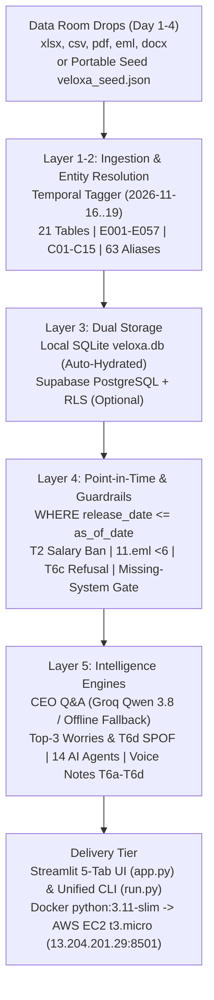

<div align="center">

# ⚡ Veloxa CXO Cockpit

### Evidence-Grounded, Point-in-Time Executive Intelligence Cockpit
**Hiyaku Systems 5-Day Hackathon (Stage 5 Final Submission) &bull; Dual-DB + 14 AI Agents + Containerized AWS EC2 Deployment**

[](https://www.python.org/)
[](https://streamlit.io/)
[](https://supabase.com/)
[](https://groq.com/)
[](Dockerfile)
[-FF9900?style=for-the-badge&logo=amazonec2&logoColor=white)](http://13.204.201.29:8501)
[](#-automated-verification-suite-3838-tests-passing)

<p align="center">
  <strong>Live Demo (AWS EC2):</strong> <a href="http://13.204.201.29:8501">http://13.204.201.29:8501</a><br />
  <strong>Health Endpoint:</strong> <a href="http://13.204.201.29:8501/_stcore/health">http://13.204.201.29:8501/_stcore/health</a><br />
  <strong>Repository:</strong> <a href="https://github.com/SaM-005X/veloxa-cockpit-samrat-sengupta">https://github.com/SaM-005X/veloxa-cockpit-samrat-sengupta</a>
</p>

</div>

---

## 🌐 Live Demo (AWS EC2)

> **Live Production Cockpit:** **[http://13.204.201.29:8501](http://13.204.201.29:8501)**  
> Hosted via Docker on an AWS Free Tier EC2 `t3.micro` instance in `ap-south-1` (Mumbai) behind a permanent Elastic IP (`13.204.201.29`), pre-hydrated across all 21 relational tables and wired to Groq Cloud (`qwen/qwen3.8-27b`) for live executive Q&A and 14-agent interviews.

| Tier | Infrastructure & Configuration | Live Endpoint / Identifier | Status |
| :--- | :--- | :--- | :--- |
| **Live Web App** | Streamlit 5-Tab Executive Cockpit (Headless Port `8501`) | [`http://13.204.201.29:8501`](http://13.204.201.29:8501) | **Active & Verified (`HTTP 200`)** |
| **Health Probe** | Native Streamlit Healthcheck Endpoint (`HEALTHCHECK`) | [`http://13.204.201.29:8501/_stcore/health`](http://13.204.201.29:8501/_stcore/health) | **Healthy (`200 ok`)** |
| **AWS Compute** | EC2 `t3.micro` Free Tier (`ap-south-1`, Ubuntu 24.04 LTS, 20 GB `gp3` + 2 GiB swap) | Instance `i-0433e61a5a6e61302` &bull; EIP `13.204.201.29` | **Running** |
| **Container Image** | `python:3.11-slim` with pre-seeded 21-table `veloxa.db` | `veloxa-cockpit:latest` (`docker compose up -d --build`) | **Healthy** |
| **LLM Synthesis** | Groq Cloud (`qwen/qwen3.8-27b` primary + deterministic SQL fallback) | Live Chatbot & 14 Colleague AI Personas | **Active** |
| **Release Baseline** | **Stage 5 — Final Submission & Code Freeze (`2026-11-20`)** | 38/38 Pytest Assertions Passing | **Frozen & Verified** |

---

## 🎯 What is Veloxa CXO Cockpit?

**Veloxa CXO Cockpit** is an evidence-grounded, point-in-time executive intelligence platform built for **Veloxa Technologies** during the **Hiyaku Systems 5-Day Hackathon**. Instead of letting an LLM hallucinate over messy enterprise files, every metric, conflict, resignation impact calculation, and policy refusal is computed deterministically in SQL/Python with atomic citations before prose synthesis.

### Key Features (All 7 Hackathon Must-Haves)

1. **Multi-Format Data Room Ingestion & Entity Resolution (Days 1–4):** Parses `.xlsx`, `.csv`, `.pdf`, `.eml`, and `.docx` drops into 21 relational tables (`19` canonical employees `VX001`–`VX019`, strict separation of FTE `Sneha VX012` vs. contractor `Snehal EXT001`, `63` aliases & ASR mishearings, dual GitHub email resolution for `VX007` = `588` commits, `1,453` IST git commits, `62` Jira issues, `11` PagerDuty incidents, and `17` on-call weeks).
2. **Dual-Backend Storage & Offline Fresh-Clone Portability:** Runs natively on a local SQLite mirror (`veloxa.db`) auto-hydrated from the tracked, path-sanitized portable seed [`data/seed/veloxa_seed.json`](data/seed/veloxa_seed.json) (`db/seed.py`) with seamless **Supabase PostgreSQL + Row Level Security (RLS)** parity across all 21 tables when `DATABASE_URL` is configured.
3. **Strict 4-Day Point-in-Time ("Time Machine") Isolation:** Enforces `WHERE release_date <= :as_of_date` across `2026-11-16` (Day 1) through `2026-11-19` (Day 4), storing Day 4 resignations non-mutatingly so earlier dates exhibit **zero future leakage**.
4. **Evidence Index & Cross-Source Contradiction Graph:** Tracks `57` immutable atomic claims (`E001`–`E057`) with exact file/sheet/row coordinates and `15` explicit cross-source conflicts (`C01`–`C15`), raising `sources_disagree = True` whenever executive verbal claims contradict operational systems.
5. **Default Landing View ("What Should I Worry About? Top 3") & `T6d` SPOF Analyzer:** Opens to the Top 3 ranked strategic worries per CEO Voice Note `T6a` (retaining `#4+` items in an expandable audit drawer), paired with `analyze_resignation_impact()` quantifying Priya Nair's (`VX007`) Day 4 SPOF blast radius (`35/62` Jira stories, `14/27` open = `62/115` open pts, `100% ATLAS-2`, `69.8%` `atlas-engine` commits, frozen backfill `REQ-014`/`REQ-015`, `VX013` 46-day notice precedent).
6. **Hard Policy Guardrails, Refusals & Epistemic Honesty:** Refuses individual salary lookups (`T2`), `< 6` team Culture Amp raw comments (`11.eml`), and quit-risk ranking or private Slack (`"slag"`) surveillance (`T6c`, `status="refused_guardrail"`), while returning explicit `"I don't know"` (`status="missing_data"`) for unexported systems (`Slack`, `HubSpot`, `LinkedIn`, `REQ-012`, `Linear`, `Confluence`, post-Sep GL/payroll).
7. **Grounded CEO Q&A, 14 Colleague AI Agents & Voice Note Governance (`T6a`–`T6d`):** Interactive CEO Q&A powered by Groq `qwen/qwen3.8-27b` (with automatic `llama-3.3-70b-versatile` / `openai/gpt-oss-120b` + offline SQL fallback), 14 colleague personas across Engineering, Finance, People & Ops, and Marketing (1-on-1 Interviews + Panel Cross-Check with Cockpit Truth Synthesis and `[Assumed]` personal context), temporal `reporting_lines` (`T6b`), and formal decision briefs in [`voice_notes/`](voice_notes/).

---

## 🏛️ System Architecture



---

## 🚀 Quick Start (One-Command Fresh Clone)

Evaluators can verify the entire pipeline, database hydration, Top 3 worries, and all 38 automated tests from a clean clone with zero `.env`, zero API keys, and zero raw archives:

```bash
pip install -r requirements.txt && python run.py --setup --ingest-all --worries --status --test
```

How fresh-clone hydration works automatically:
- If `VELOXA_DATA_DIR` points to mounted `Veloxa_Hackathon_Release_Packs`, `--ingest-all` parses all raw Day 1–4 files and syncs both `veloxa.db` and Supabase PostgreSQL.
- If `VELOXA_DATA_DIR`, `DATABASE_URL`, and `GROQ_API_KEY` are **unset**, `--ingest-all` automatically hydrates a clean `veloxa.db` SQLite database from [`data/seed/veloxa_seed.json`](data/seed/veloxa_seed.json), prints the deterministic Top 3 worries, verifies all 21 table counts, and runs the 38-test Pytest suite.

### Launch the Streamlit Executive Web UI

```bash
streamlit run app.py
```
*(Or run `python run.py --setup --ingest-all --ui` in a single command.)*

The dashboard opens directly to **Tab 1: "What Should I Worry About? (Top 3)"** with a sidebar **Time Machine Selector** (`2026-11-19` back to `2026-11-16`), **Day 4 `T6d` Board Crisis Spotlight**, **Voice Note Responses (`T6a`–`T6d`)**, **Evidence & Conflict Explorer**, **Grounded CEO Q&A Chatbot**, and **14 Colleague AI Agents** (1-on-1 & Panel Cross-Check).

<details>
<summary><strong>🛠️ Full CLI Reference (<code>run.py</code>) & Optional <code>.env</code> Variables</strong></summary>

```bash
# Schema setup & ingestion
python run.py --setup
python run.py --ingest-day1            # through --ingest-day4
python run.py --ingest-all
python run.py --seed                   # Hydrate SQLite from portable seed
python run.py --export-seed            # Export sanitized JSON seed snapshot

# Executive intelligence commands
python run.py --worries --as-of 2026-11-19
python run.py --impact VX007 --as-of 2026-11-19
python run.py --ask "What does Priya Nair's resignation do to Atlas v3?" --as-of 2026-11-19
python run.py --interview VX007 "How is Atlas v3 workload going for you?" --as-of 2026-11-19
python run.py --panel "VX006,VX003" "What was our half-year Marketing spend?" --as-of 2026-11-19

# Diagnostics, tests & UI
python run.py --status
python run.py --test
python run.py --ui
```

All core features and tests run **with zero `.env` configuration**. To enable optional cloud PostgreSQL parity or Groq LLM synthesis, copy `.env.example` to `.env`:

| Variable | Purpose | Default / Behavior When Unset |
| :--- | :--- | :--- |
| `GROQ_API_KEY` | Groq Cloud API key for CEO Q&A & 14 AI agents | Falls back deterministically to SQL + evidence-index synthesis |
| `GROQ_MODEL` | Primary Groq model override | Defaults to `qwen/qwen3.8-27b` (`llama-3.3-70b-versatile` & `openai/gpt-oss-120b` fallback) |
| `DATABASE_URL` | Supabase PostgreSQL connection string | Uses pre-seeded local `veloxa.db` SQLite mirror seamlessly |
| `VELOXA_DATA_DIR` | Path to mounted `Veloxa_Hackathon_Release_Packs` | Auto-hydrates from tracked `data/seed/veloxa_seed.json` |

</details>

---

## 🐳 Docker Quick Start

The repository ships with a production [`Dockerfile`](Dockerfile) (`python:3.11-slim`), [`.dockerignore`](.dockerignore), and [`docker-compose.yml`](docker-compose.yml) that pre-hydrate all 21 SQLite tables at build time (`python run.py --setup --seed`) and expose a native `/_stcore/health` probe on port `8501`.

### Option 1: Docker Compose (Recommended)
*(Automatically picks up `.env` if present; runs cleanly offline if `.env` is absent.)*

```bash
docker compose up --build
```

### Option 2: Direct Docker Build & Run

```bash
docker build -t veloxa-cockpit:latest .
docker run --rm -p 8501:8501 veloxa-cockpit:latest
```

Once started, open **[http://localhost:8501](http://localhost:8501)** (healthcheck: `http://localhost:8501/_stcore/health`).

---

## 🧪 Automated Verification Suite (38/38 Tests Passing)

```bash
python -m pytest -v
```

Covers Stages 1 through 5 across:
- **Dual-DB & Seed Portability:** 21-table schema initialization, SQLite/Supabase parity, and path-sanitized fresh-clone hydration (`data/seed/veloxa_seed.json`).
- **Day 1–4 Ingestion & Entity Resolution:** Real Excel/CSV/PDF/EML/DOCX reconciliation (`1,453` git commits, `62` Jira issues, `11` incidents, `17` on-call weeks, `Sneha` vs `Snehal`, `VX007` dual GitHub email resolution).
- **12 Refusal, Uncertainty & Point-in-Time Tests:** `T2` individual salary refusals across full/first-name variants, `11.eml` `< 6` survey anonymity, `T6c` quit-risk ranking & Slack scraping refusal (`status="refused_guardrail"`), explicit `"I don't know"` missing-system gates, and strict 4-day historical non-leakage (`2026-11-16`..`2026-11-19`).
- **Executive Intelligence & Personas:** Grounded CEO Q&A citations, conflict detection (`sources_disagree == True`), `T6d` resignation SPOF impact (`VX007`), temporal `reporting_lines` (`T6b`), and all 14 AI colleague personas.

---

## 📂 Repository Structure

```text
veloxa-cockpit-samrat-sengupta/
├── Dockerfile                  # python:3.11-slim container with 21-table pre-hydration & HEALTHCHECK
├── .dockerignore               # Excludes .git, .venv, .env, local veloxa.db, caches, private/handoff docs
├── docker-compose.yml          # One-command containerized launch on port 8501 (optional .env)
├── app.py                      # Streamlit CXO Cockpit 5-tab Executive UI & Time Machine
├── run.py                      # Unified single-command CLI runner
├── requirements.txt            # Pinned Python dependencies
├── .env.example                # Optional environment template (GROQ_API_KEY, DATABASE_URL, etc.)
├── agents/
│   └── persona.py              # 14 Colleague AI Personas (1-on-1 Interview & Panel Cross-Check)
├── cockpit/
│   ├── guardrails.py           # Salary, Anonymity, Non-Surveillance, Missing-Data & PIT Guardrails
│   ├── qa_engine.py            # Grounded CEO Q&A Engine (Groq Qwen 3.8 + Deterministic Fallback)
│   └── risk_engine.py          # Ranked Top 3 Worries (T6a) & Resignation SPOF Impact (T6d)
├── db/
│   ├── schema.sql              # Unified PostgreSQL + SQLite DDL across all 21 tables
│   ├── database.py             # Dual-backend manager & temporal get_reporting_line_as_of()
│   └── seed.py                 # Path-sanitized portable seed exporter & offline hydrator
├── data/seed/
│   └── veloxa_seed.json        # Tracked normalized Day 1-4 DB snapshot for fresh clones
├── ingest/
│   ├── temporal.py             # Official release calendar & temporal tagging
│   └── day1_loader.py..day4_loader.py
├── voice_notes/
│   └── T6a_response.md..T6d_response.md
└── tests/
    ├── conftest.py             # Session autouse offline hydration fixture
    └── test_stage1_foundation.py..test_stage5_submission.py  # 38 automated tests
```

---

## 📚 Governance Documentation

| Document | Scope & Contents |
| :--- | :--- |
| **[`ARCHITECTURE.md`](ARCHITECTURE.md)** | 5-layer system design, dual storage, entity resolution, guardrails, Q&A, 14 agents, Docker & AWS EC2 architecture |
| **[`ASSUMPTIONS.md`](ASSUMPTIONS.md)** | Logged assumptions (`A01`–`A34`), including all 14 colleague personal-life profiles and Stage 5 seed rules |
| **[`TRANSCRIPT_NOTES.md`](TRANSCRIPT_NOTES.md)** | Verified ASR mishearings and cross-source contradictions (`C01`–`C15`) across `T1`–`T6d` |
| **[`DECISIONS.md`](DECISIONS.md)** | Architectural and product trade-offs (`D01`–`D13`) |
| **[`AI_LOG.md`](AI_LOG.md)** | Full Stage 1–5 + deployment audit log of AI-assisted tasks, mistakes caught, and human verification |

---

<div align="center">

Built by **Samrat Sengupta** ([@SaM-005X](https://github.com/SaM-005X)) &bull; Hiyaku Systems 5-Day Hackathon

</div>
